# Laboratorio 6: planetas y estrellas con shaders

Software renderer en CPU escrito en Rust (el de los laboratorios 4 y 5, ampliado con vertex shader, prueba de profundidad y fragment shaders). Dibuja **siempre la misma esfera** (`assets/sphere.obj`, 98 vértices y 192 triángulos, sin modificar) y la convierte en tres mundos distintos cambiando **solo el fragment shader**. No hay texturas ni imágenes: todo el color sale de ruido, funciones matemáticas e iluminación calculados por fragmento.

| Pyrene (estrella) | Thalassa (planeta rocoso) | Nyxara (gigante gaseoso) |
|---|---|---|
| 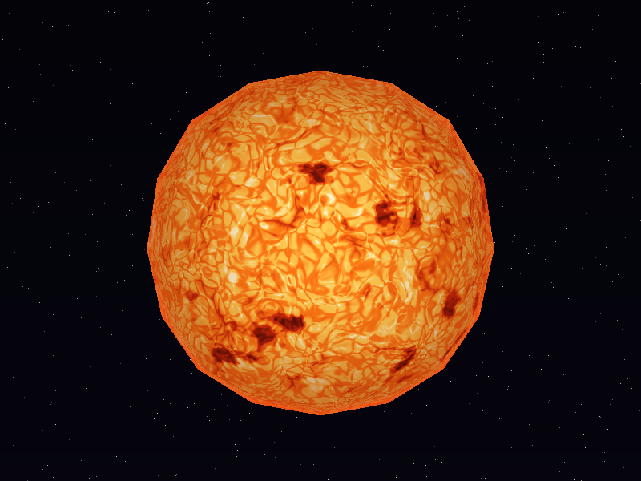 | 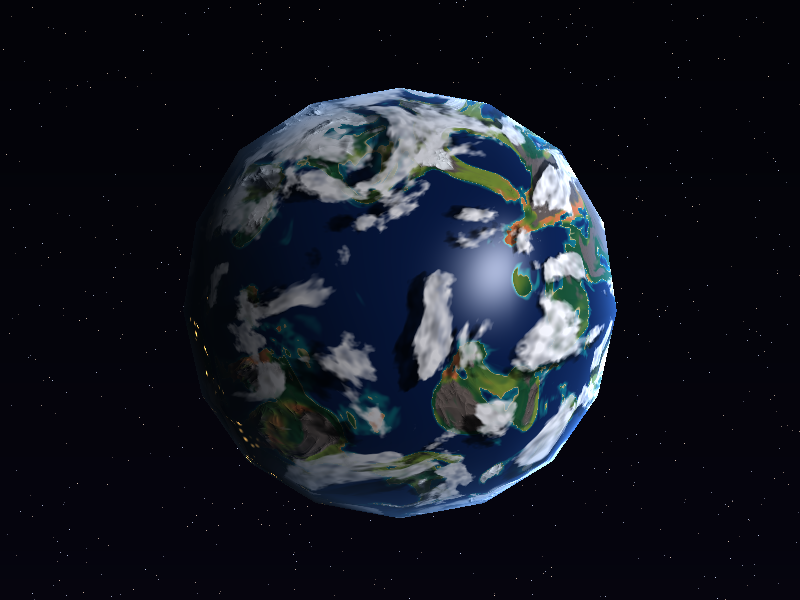 |  |
| Superficie activa que hierve: granulación, filamentos, manchas y oscurecimiento del limbo. | Océanos, biomas, montañas con relieve, nubes con sombras y ciudades de noche. | Bandas que fluyen como un líquido y tormentas que las curvan. |

---

## Cómo compilarlo y ejecutarlo

Requisitos: Rust 1.85 o más reciente (edición 2024) y lo que necesita [raylib](https://crates.io/crates/raylib) para compilarse (`cmake`, un compilador de C y, en Linux, las bibliotecas de desarrollo de X11 o Wayland).

```bash
cargo run --release                      # ventana interactiva (empieza con la estrella)
cargo run --release -- --body rocky      # empieza con otro cuerpo: star | rocky | gas
cargo run --release -- --bench           # tiempo por cuadro de cada cuerpo, sin ventana
cargo run --release -- --export docs     # regenera las capturas de docs/img (y los cuadros de los clips)
scripts/make_gifs.sh                     # capturas + GIF de docs/gif (requiere ffmpeg)
cargo test --release                     # pruebas automáticas
```

Usen siempre `--release`: en modo debug el ruido es decenas de veces más lento.

### Seleccionar el shader y controles

| Tecla | Acción |
|---|---|
| `1` / `2` / `3` | **Estrella / planeta rocoso / gigante gaseoso** (cambia el fragment shader) |
| Arrastrar con el ratón o flechas | Orbitar la cámara |
| Rueda o `W` / `S` | Acercar / alejar |
| `J` / `L`, `I` / `K` | Mover la luz (azimut / elevación) |
| `O` | La luz orbita sola alrededor del planeta |
| `Tab` / `Shift+Tab` | Elegir un parámetro del shader activo (se marca con `>` en el panel) |
| `Q` / `E` | Bajar / subir el parámetro, o encenderlo/apagarlo si es un interruptor |
| `R` | Restaurar los parámetros del cuerpo actual |
| `Espacio` | Pausar la animación |
| `F` | Media resolución (4 veces menos fragmentos, para máquinas lentas) |
| `P` | Guardar una captura en `screenshots/` |
| `H` | Ocultar el panel |

El panel muestra el cuerpo activo, los fps, el tiempo de render, la cantidad de fragmentos y **todos los parámetros del shader con su valor actual**, así que cualquier parámetro de las tablas de abajo se puede cambiar en vivo.

---

## Cómo está hecho

### El pipeline

```text
vertex shader → ensamblaje de primitivas → descarte de caras traseras → rasterización
  (baricéntrica, con corrección de perspectiva y prueba de profundidad) → fragment shader → framebuffer
```

| Archivo | Qué hace |
|---|---|
| `src/mesh.rs` | Carga el OBJ (cargador del laboratorio 4). El archivo trae una normal por cara, así que cada vértice recibe el promedio de las normales de sus caras: la esfera se ilumina suave **sin mover ningún vértice**. |
| `src/pipeline.rs` | `vertex_shader` (modelo → vista → proyección → viewport), `rasterize_triangle` (coordenadas baricéntricas con la regla top-left del laboratorio 5 e interpolación con corrección de perspectiva) y `render`, que reparte el fragment shader entre los núcleos con `rayon`. Cada fragmento lleva su posición en el mundo y en el modelo, la normal interpolada y la **intensidad `max(0, n·l)`** que calcula el renderer. |
| `src/shaders/mod.rs` | `Uniforms` (matrices, tiempo, luz, cámara, parámetros) y `fragment_shader`, que elige el shader del cuerpo activo. |
| `src/shaders/noise.rs` | Ruido **OpenSimplex2** 3D, Voronoi (Worley), fBm, ruido *ridged* y deformación de dominio. |
| `src/shaders/star.rs`, `rocky.rs`, `gas_giant.rs` | Los tres fragment shaders. |
| `src/scene.rs` | Cámara orbital, dirección de la luz, tiempo y la lista de parámetros ajustables del panel. |
| `src/export.rs` | Capturas y clips reproducibles (cada uno es una escena con parámetros fijos). |

Todos los shaders reciben el punto de la esfera unitaria `p = normalize(posición en el modelo)` y muestrean el ruido **en 3D** sobre él. Así no hay costuras ni polos deformados como los que tendría un ruido 2D sobre latitud/longitud.

### Ruido

- `simplex(p)`: OpenSimplex2 3D (port del de FastNoise Lite; una prueba compara contra el crate `fastnoise-lite` y da el mismo valor).
- `fbm(p, octavas)`: varias capas de simplex, cada una al doble de frecuencia y la mitad de amplitud.
- `ridged(p, octavas)`: `(1 - |simplex|)²`, forma crestas finas (cordilleras, filamentos).
- `warp(p)`: tres fBm que se suman a `p` antes de muestrear otro ruido; curva las formas (continentes orgánicos, plasma, nubes).
- `worley(p)`: distancias al punto de Voronoi más cercano (F1) y al segundo (F2). `F2 - F1` vale 0 en los bordes de las celdas.

---

## 1. Pyrene, la estrella (`src/shaders/star.rs`, `shade`)


Todas las capas se combinan en un único campo de **temperatura** que al final pasa por una rampa de cuerpo negro (rojo oscuro → naranja → dorado → blanco). Combinar en temperatura, y no en color, hace que todas las capas compartan la misma paleta y se vean como un solo material.

1. **Plasma**: fBm de baja frecuencia con deformación de dominio. El campo de deformación avanza con el tiempo, así que el plasma **hierve**.
2. **Granulación**: celdas de Voronoi (`F2 - F1`) deformadas por el mismo campo. Los bordes entre celdas son más fríos, como las celdas de convección del Sol.
3. **Filamentos**: ruido *ridged* elevado al cubo (solo las crestas más altas) que además parpadea con una fase distinta en cada zona.
4. **Manchas**: un fBm lento con dos umbrales (penumbra y umbra) y solo en dos **cinturones de latitud** (≈10°–40°), como en el Sol. Enfrían la temperatura.
5. **Oscurecimiento del limbo**: depende de `n · v`. El borde del disco se ve más oscuro y rojo, y un halo naranja marca la cromosfera.
6. **Rotación diferencial**: el ecuador gira más rápido que los polos.

La estrella es emisiva: **no usa la intensidad de la luz externa** (sería raro que el sol tuviera un lado de noche).

| Parámetro (panel) | Campo | Por defecto | Qué cambia |
|---|---|---:|---|
| granulación (escala) | `granulation_scale` | 16 | Frecuencia de las celdas: más alto = celdas más pequeñas. |
| velocidad de hervor | `boil_speed` | 0.35 | Qué tan rápido se deforma el plasma. 0 = la superficie se congela. |
| manchas | `spot_amount` | 1.0 | 0 = sin manchas ([sin manchas](docs/img/star_no_spots.png)); 2 = manchas más oscuras. |
| oscurecimiento del limbo | `limb_darkening` | 0.7 | 0 = disco plano; 1 = borde casi negro. |

## 2. Thalassa, el planeta rocoso (`src/shaders/rocky.rs`, `shade`)


1. **Campo de altura** (`continents` + `relief`): fBm con deformación de dominio da continentes de formas orgánicas; un ruido *ridged* agrega cordilleras que solo crecen tierra adentro. `sea_level` decide qué es océano.
2. **Biomas**: la altura, la latitud y un fBm de humedad dan una "temperatura" y una "humedad" por punto, y con transiciones suaves (`smoothstep`) eligen entre playa, pradera, bosque, desierto, roca y nieve. El océano pasa de turquesa a azul profundo según la profundidad y los polos tienen hielo marino con borde irregular.
3. **Relieve** (bump mapping), **materiales** (agua especular / tierra mate), **sombras de nubes**, **ciudades nocturnas**, **nubes** y **atmósfera**: ver la sección de efectos.

El terreno y las nubes giran a velocidades distintas alrededor de un eje inclinado 23°.

| Parámetro (panel) | Campo | Por defecto | Qué cambia |
|---|---|---:|---|
| nivel del mar | `sea_level` | 0.04 | Más alto = más océano, continentes más pequeños. |
| bump mapping | `bump` | ON | Enciende/apaga el relieve. |
| fuerza del relieve | `bump_strength` | 1.0 | Cuánto inclina la pendiente a la normal (0 = liso). |
| especular del océano | `specular` | ON | Enciende/apaga el reflejo del sol en el agua. |
| brillo del océano (exp.) | `ocean_shininess` | 70 | Exponente de Blinn-Phong: más alto = reflejo más pequeño y nítido. |
| luces de ciudades | `city_lights` | ON | Enciende/apaga las ciudades del lado nocturno. |
| nubes | `clouds` | ON | Enciende/apaga la capa de nubes. |
| cobertura de nubes | `cloud_coverage` | 0.45 | Fracción del cielo cubierta (0 = despejado, 1 = cubierto). |
| sombras de nubes | `cloud_shadows` | ON | Enciende/apaga las sombras. |
| altura de las nubes | `cloud_height` | 0.07 | Altura de la capa (radio = 1): más alto = sombra más separada de su nube. |
| intensidad de sombra | `shadow_strength` | 0.85 | Cuánto oscurece una nube densa. |
| velocidad del terreno | `terrain_speed` | 0.03 | Rotación del terreno (rad/s). |
| velocidad de las nubes | `cloud_speed` | 0.09 | Rotación de las nubes (rad/s), independiente del terreno. |

## 3. Nyxara, el gigante gaseoso (`src/shaders/gas_giant.rs`, `shade`)


1. **Bandas** (`band_color`): la latitud se perturba con fBm **estirado en longitud** (frecuencia 7 en `y` y 2.6 en `x`/`z`, así los remolinos son alargados) y entra en un seno; una segunda onda lenta separa zonas claras de cinturones oscuros, y un ruido aún más estirado agrega vetas finas. El resultado recorre una paleta índigo → violeta → lavanda → hielo → aguamarina.
2. **Flujo líquido** (`advect`, `flowing_color`): cada latitud avanza a su propia velocidad (chorros que alternan este/oeste) y el gas gira dentro de cada tormenta. Para que el patrón no se estire sin fin se usan **dos fases** desfasadas medio período que se reinician y se mezclan con pesos triangulares (técnica de *flow map*). Los chorros se apagan dentro de las tormentas para que el vórtice no se deforme.
3. **Tormentas** (`swirl`): ver la sección de efectos.
4. **Iluminación**: difusa "envuelta" (terminador suave, como una atmósfera densa), oscurecimiento del limbo, bruma polar y una bruma lavanda iluminada en el borde.

| Parámetro (panel) | Campo | Por defecto | Qué cambia |
|---|---|---:|---|
| frecuencia de bandas | `band_frequency` | 13 | Cantidad de bandas. |
| turbulencia | `turbulence` | 0.11 | Cuánto se ondulan los bordes de las bandas (0 = franjas rectas). |
| velocidad del flujo | `flow_speed` | 1.0 | Qué tan rápido fluyen los chorros y giran las tormentas (0 = quieto). |
| fuerza de tormentas | `storm_strength` | 1.0 | Cuánto enroscan las tormentas a las bandas (0 = sin vórtices). |

---

## Efectos adicionales implementados

| Efecto | Puntos | Cuerpo | Archivo y función | Evidencia |
|---|---:|---|---|---|
| Material animado | 5 | Estrella | `star.rs` → `shade` (campo `warp` con tiempo, parpadeo de filamentos) | [`star_boil.gif`](docs/gif/star_boil.gif) |
| Apariencia de día y noche | 5 | Planeta rocoso | `rocky.rs` → `shade` (bloque "Lado nocturno: ciudades") | [`rocky_night.png`](docs/img/rocky_night.png), [`rocky_light_orbit.gif`](docs/gif/rocky_light_orbit.gif) |
| Respuestas diferentes a la iluminación | 10 | Planeta rocoso | `rocky.rs` → `shade` (bloque "Respuesta a la luz según el material") | [`rocky_specular_orbit.gif`](docs/gif/rocky_specular_orbit.gif), [sin](docs/img/rocky_specular_off.png) / [con](docs/img/rocky_specular_on.png) especular |
| Nubes procedurales | 10 | Planeta rocoso | `rocky.rs` → `cloud_density`, `cloud_frame` | [`rocky_clouds.gif`](docs/gif/rocky_clouds.gif), cobertura [baja](docs/img/rocky_clouds_low.png) / [alta](docs/img/rocky_clouds_high.png) |
| Tormenta o vórtice localizado | 10 | Gigante gaseoso | `gas_giant.rs` → `swirl`, `advect` | [`gas_flow.gif`](docs/gif/gas_flow.gif), [sin](docs/img/gas_storms_off.png) / [con](docs/img/gas_storms_on.png) tormentas, [acercamiento](docs/img/gas_storm_closeup.png) |
| Relieve procedural mediante bump mapping | 15 | Planeta rocoso | `rocky.rs` → `relief`, `bumped_normal` | [`rocky_bump.gif`](docs/gif/rocky_bump.gif), [sin](docs/img/rocky_bump_off.png) / [con](docs/img/rocky_bump_on.png) relieve |
| Sombras de nubes | 20 | Planeta rocoso | `rocky.rs` → `cloud_shadow_point` (y su uso en `shade`) | [`rocky_cloud_shadows.gif`](docs/gif/rocky_cloud_shadows.gif), [sin](docs/img/rocky_shadows_off.png) / [con](docs/img/rocky_shadows_on.png) sombras |

**Total solicitado:** 60 (criterios básicos) + 75 (efectos) = 135 puntos, con tope de 100. Cada efecto se pide una sola vez, y el movimiento de las nubes **no** se usa para el criterio de material animado (ese lo cubre el plasma de la estrella).

Todas las capturas y los clips se regeneran con `scripts/make_gifs.sh`; cada uno es una escena con parámetros fijos definida en `src/export.rs`.

### Material animado — estrella

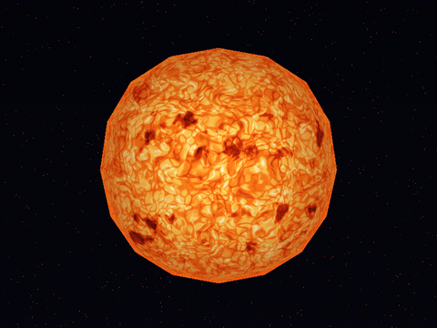

La esfera no se mueve: lo que cambia es el **campo de deformación** `w = warp(q · 2.2 + (0, t, 0.6 t))`, que se desplaza en el espacio 3D del ruido con el tiempo. Como deforma al mismo tiempo el plasma, las celdas de granulación y los filamentos, toda la superficie se reorganiza ("hierve") sin desplazarse. Además los filamentos pulsan con `sin(2.1 t + 14 · plasma)`, una fase distinta en cada zona, y las manchas derivan muy despacio.

**Parámetro:** `velocidad de hervor` (`boil_speed`). Con 0 la superficie queda quieta; con 1.0 o más hierve visiblemente rápido.

### Apariencia de día y noche — planeta rocoso

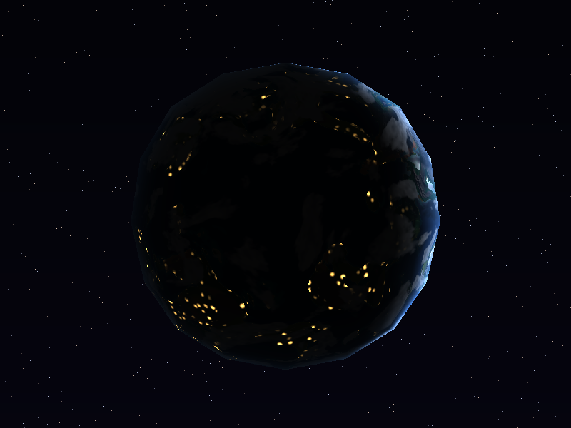

Las ciudades son puntos de Voronoi (`cell_distance(q · 22)` cerca de 0) que solo aparecen en tierra **habitable**: se multiplican por la máscara de tierra y se descartan en nieve, montaña y casi todo el desierto. Se agrupan en regiones (un fBm de baja frecuencia) y se concentran cerca de las costas. Se multiplican por `night = smoothstep(0.05, -0.2, n·l)`, que vale 1 donde no llega el sol y se apaga suavemente al cruzar el terminador, así que **del lado iluminado no se ven**. Las nubes las tapan (`× (1 - 0.85 · nube)`). En [`rocky_light_orbit.gif`](docs/gif/rocky_light_orbit.gif) la luz da una vuelta y las ciudades se encienden y apagan siguiendo al terminador.

**Parámetro:** `luces de ciudades` (interruptor). Para verlo en la ventana: `2`, luego mantener `L` hasta que la cara visible quede de noche, o `O` para que la luz orbite.

### Respuestas diferentes a la iluminación — planeta rocoso

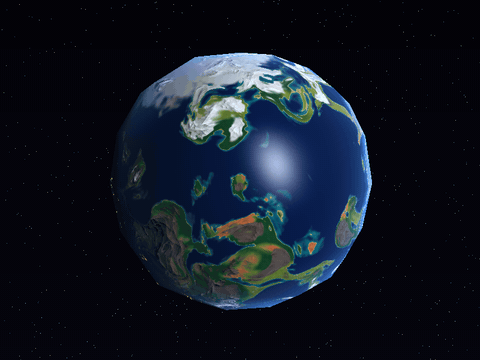

Cada punto tiene un material según su máscara:

- **Océano**: difuso + especular Blinn-Phong `(n · h)^70` multiplicado por un término de Fresnel (Schlick, `0.04 + 0.96 (1 - n·v)^5`): un reflejo nítido del sol que se intensifica hacia el borde del disco.
- **Hielo y nieve**: brillo suave y ancho (`(n · h)^10` con intensidad 0.08).
- **Tierra**: solo difusa (mate).

En el GIF la luz está fija y la **cámara** orbita: el reflejo del océano se mueve con la vista y se corta en las costas, mientras que los continentes no cambian. Comparación [sin](docs/img/rocky_specular_off.png) / [con](docs/img/rocky_specular_on.png) especular.

**Parámetros:** `especular del oceano` (interruptor) y `brillo del oceano (exp.)`: con 20 el reflejo ocupa casi medio océano; con 200 es un punto pequeño.

### Nubes procedurales — planeta rocoso


`cloud_density` es una máscara (0..1) que se mezcla con la superficie ya iluminada: `color = mix(superficie, blanco · luz, densidad)`. **No hay otra esfera**: es la misma superficie con una capa más de color.

- Base: fBm de 5 octavas, un poco estirado en longitud y deformado por un campo que también cambia con el tiempo (las nubes cambian de forma, no solo se desplazan).
- Un umbral con `smoothstep` decide qué es nube; el umbral sale de `cloud_coverage`.
- Un ruido fino de alta frecuencia erosiona la nube: bordes deshilachados y huecos en lugar de manchas lisas.
- Las nubes se muestrean en `cloud_frame`, que gira a `cloud_speed`, distinto de `terrain_speed` del terreno. En el GIF el terreno está quieto y las nubes avanzan (velocidad ×6 para que se note en un clip corto).

**Parámetros:** `cobertura de nubes` ([0.2](docs/img/rocky_clouds_low.png) vs. [0.75](docs/img/rocky_clouds_high.png)) y `velocidad de las nubes`.

### Tormenta o vórtice localizado — gigante gaseoso

| Sin tormentas | Con tormentas |
|---|---|
| 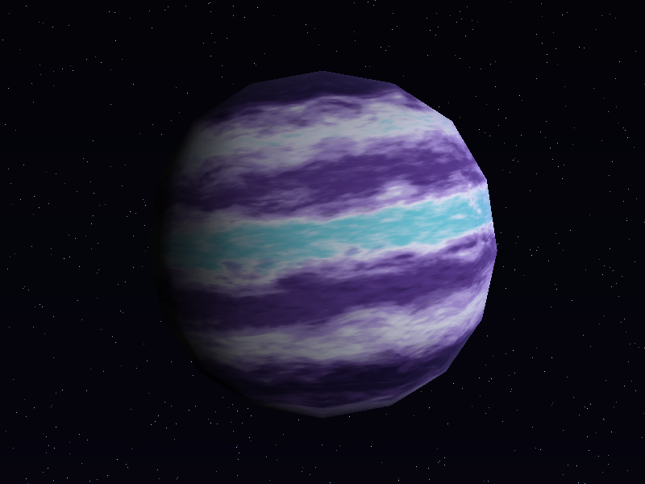 | 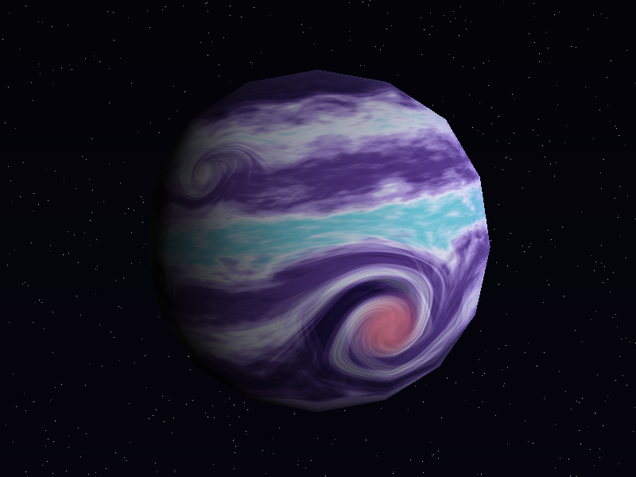 |

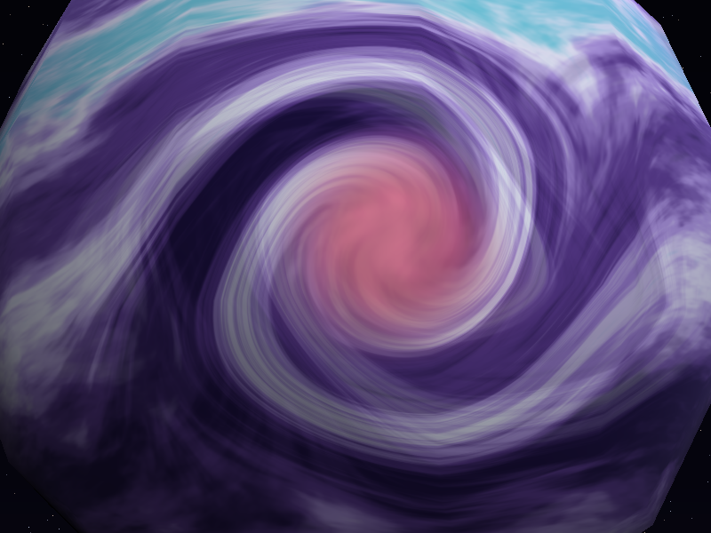

No se dibuja un círculo encima: **se deforma el espacio donde se calculan las bandas**. Para cada tormenta, el punto de muestreo se rota alrededor del eje que pasa por su centro (fórmula de Rodrigues, `rotate_axis`) con un ángulo `swirl · exp(-(d/r)²)`, máximo en el centro y casi nulo a dos radios. Las bandas que pasan cerca quedan enroscadas en espiral y las lejanas no cambian. Hay una gran tormenta rosada en el hemisferio sur y dos óvalos blancos (uno gira en sentido contrario). El núcleo se tiñe del color de la tormenta pero conserva las vetas en espiral.

En [`gas_flow.gif`](docs/gif/gas_flow.gif) el gas gira dentro de cada tormenta (`advect`) mientras la forma del vórtice queda fija, así que las bandas **fluyen a través** del vórtice y se curvan a su paso.

**Parámetro:** `fuerza de tormentas` (`storm_strength`): 0 = bandas rectas; 1 = espiral; 2 o más = espirales muy cerradas.

### Relieve procedural mediante bump mapping — planeta rocoso

| Sin relieve | Con relieve |
|---|---|
| 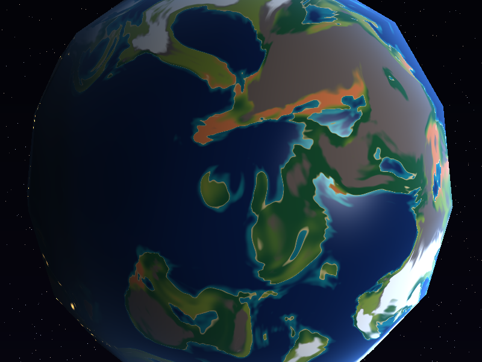 | 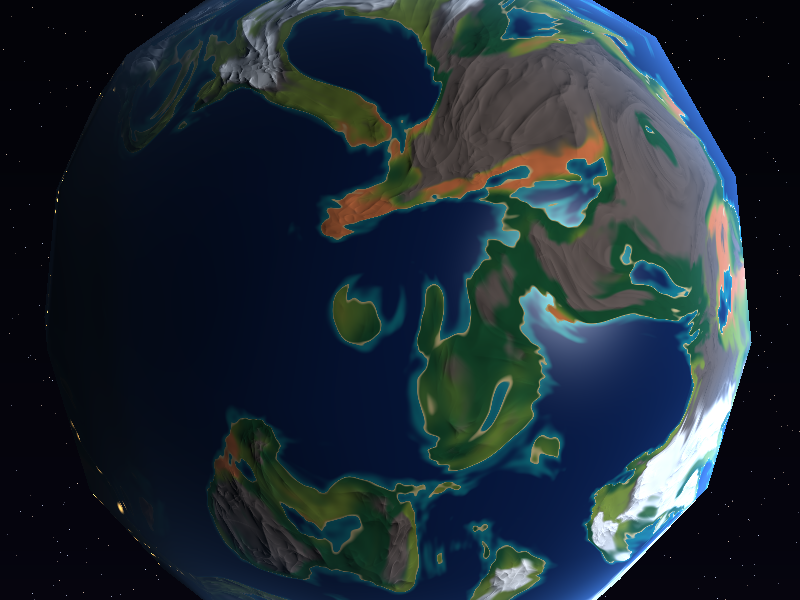 |

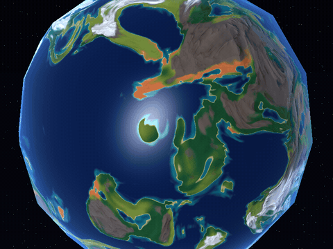

`relief(q)` (cordilleras *ridged* + rugosidad fina) es un campo de altura sobre la esfera. `bumped_normal` lo evalúa en el punto y en dos vecinos desplazados `ε = 0.003` sobre dos direcciones tangentes `T` y `B`, y arma el gradiente con diferencias finitas:

```text
∇h ≈ T · (h(p + εT) - h(p)) / ε + B · (h(p + εB) - h(p)) / ε
n' = normalize(n - k · ∇h)
```

La normal se inclina en contra de la pendiente, así que las laderas que miran a la luz se aclaran y las otras se oscurecen. **Los vértices no se mueven**: solo cambia la normal con la que se calcula la difusa y el especular. En el GIF la luz gira y las sombras de las montañas cambian de lado. El terminador se calcula con la normal geométrica, así que el relieve no puede iluminar el lado nocturno.

**Parámetros:** `bump mapping` (interruptor) y `fuerza del relieve` (`k`): 0 = liso; 3 o más = relieve muy exagerado.

### Sombras de nubes — planeta rocoso

| Sin sombras | Con sombras |
|---|---|
| 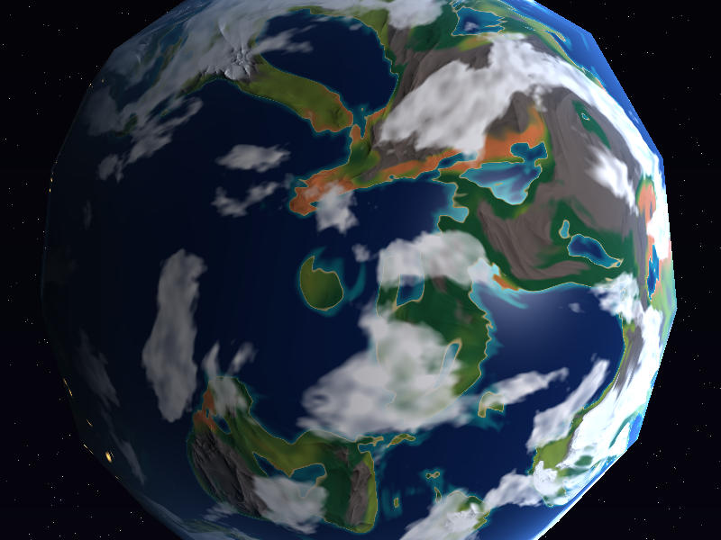 | 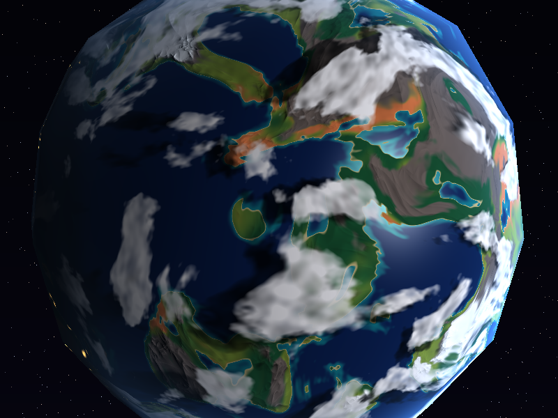 |

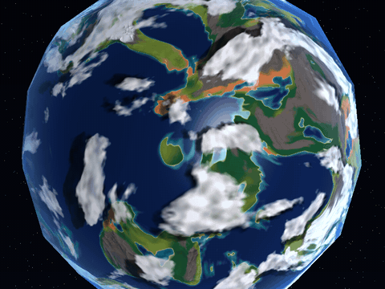

Las nubes están en una capa de radio `R = 1 + cloud_height`. Para saber si un punto `p` de la superficie está en sombra, `cloud_shadow_point` sigue el rayo desde `p` **hacia la luz** `l` hasta esa capa, resolviendo `|p + t·l| = R`:

```text
t = -(p·l) + sqrt((p·l)² - 1 + R²)
punto de la nube = normalize(p + t·l)
```

Ahí se evalúa la **misma** función `cloud_density` (con la misma rotación de las nubes), y la iluminación directa (difusa y especular) se multiplica por `1 - shadow_strength · densidad`. Por eso la sombra tiene exactamente la forma de su nube y se desplaza de forma coherente con la luz:

- Con el sol cenital (`l = p`), `t = cloud_height` y la sombra queda justo debajo de la nube.
- Cerca del terminador (`p·l ≈ 0`) el rayo cruza la capa lejos y la sombra se separa y se alarga, del lado opuesto a la luz.

Las dos propiedades tienen pruebas automáticas (`rocky.rs`, `tests`). En el GIF la luz se mueve y las sombras se desplazan sobre los continentes mientras las nubes quedan quietas.

**Parámetros:** `sombras de nubes` (interruptor), `altura de las nubes` (0 = sombra pegada a la nube; 0.2 = sombra muy separada) e `intensidad de sombra`.

---

## Rendimiento

`cargo run --release -- --bench` (vista por defecto, 800×600, 8 hilos, laptop en modo de ahorro de energía a ~1.3 GHz):

| Cuerpo | Fragmentos | ms por cuadro | fps |
|---|---:|---:|---:|
| Pyrene (estrella) | 145 900 | 97.6 | 10.2 |
| Thalassa (planeta rocoso) | 145 900 | 173.7 | 5.8 |
| Nyxara (gigante gaseoso) | 145 900 | 117.5 | 8.5 |

El costo está en el ruido: el planeta rocoso evalúa unas 55 muestras de simplex por fragmento (continentes, relieve y sus dos vecinos, humedad, nubes y la nube de la sombra). En una máquina lenta, `F` renderiza a media resolución (4 veces menos fragmentos).

## Pruebas

`cargo test --release` comprueba, entre otras cosas, que el OpenSimplex2 propio da los mismos valores que `fastnoise-lite`, que el cargador lee la esfera (98 vértices, 192 triángulos, normales hacia fuera), que el punto de sombra queda bajo la nube con el sol cenital y se aleja hacia la luz cuando el sol está bajo, que las fases del flujo del gigante gaseoso no producen saltos al reiniciarse y que las tormentas no afectan puntos lejanos.

## Créditos

- `sphere.obj`: proporcionado en el curso.
- OpenSimplex2 3D: port del de [FastNoise Lite](https://github.com/Auburn/FastNoiseLite) (Jordan Peck, licencia MIT; algoritmo de K.jpg). El crate `fastnoise-lite` se usa solo en la prueba que verifica el port.
- Ventana y exportación de PNG: [raylib](https://crates.io/crates/raylib). Paralelismo: [rayon](https://crates.io/crates/rayon).
